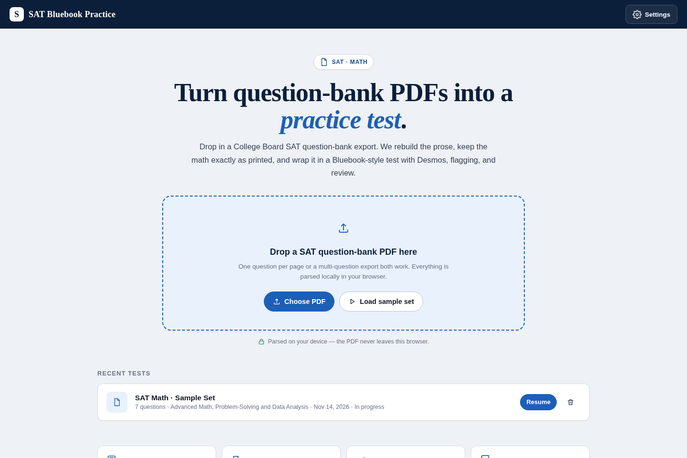

# SAT-PDF-handler

Turn standard SAT question-bank PDF exports into an interactive, Bluebook-style
practice test with Desmos embedded.



## Run

The app is fully static — no build step and no backend.

```bash
node server.js          # http://localhost:4173
```

Then open the page, choose a question-bank PDF, and start practising. Parsing
happens entirely in the browser; the PDF never leaves your device. Parsed tests
are cached locally in IndexedDB.

The built-in grapher is always available as a fallback when Desmos cannot load.

## Development notes

Parsing behaviour, test results, known issues, and the diagnostics scripts are
documented in
[Discussions #1](https://github.com/CarbonBased42/SAT-PDF-handler/discussions/1).
